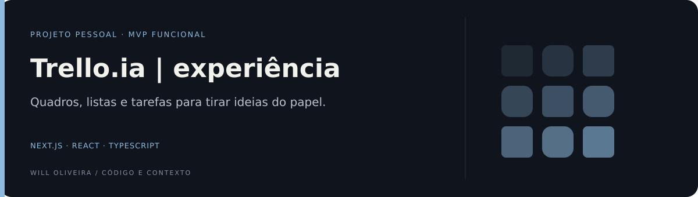
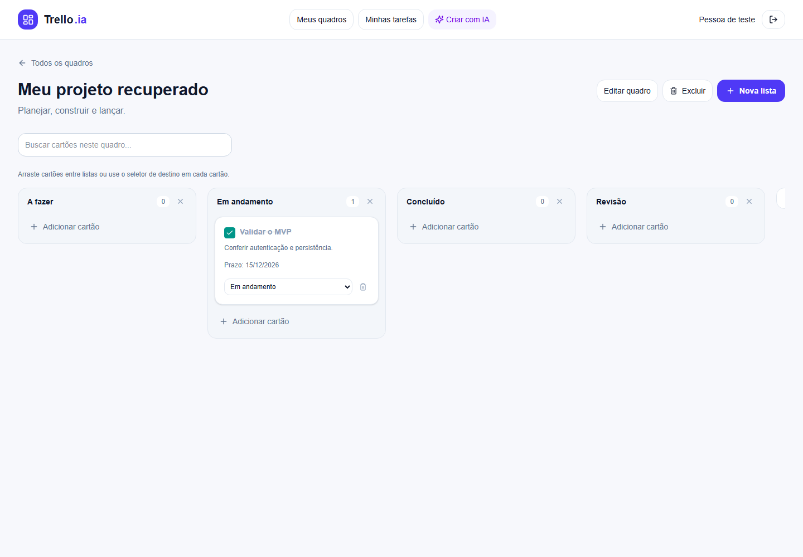

<p align="center">
  <a href="https://trello-ia-frontend-five.vercel.app"></a>
</p>

# Trello.ia · ideias em movimento

Um espaço pessoal para tirar projetos do papel: organize quadros, distribua tarefas entre etapas e acompanhe o que já foi feito. A recuperação completa a integração com a API e acrescenta persistência, autorização por usuário e geração de planos com IA.

**Next.js 15 · React 19 · TypeScript · Tailwind CSS**

[](https://github.com/Will-Ifes/trello-ia-frontend/actions/workflows/ci.yml)

[Ver online](https://trello-ia-frontend-five.vercel.app) · [Backend](https://github.com/Will-Ifes/trello-ia-backend) · [Código](src) · [Executar](#executar-com-api) · [Publicação](docs/deploy.md)

<p align="center">
  <a href="https://trello-ia-frontend-five.vercel.app"></a>
  <br />
  <sub>Interface real, validada em desktop e mobile. Dados fictícios usados nos testes.</sub>
</p>

## O que dá para fazer

- Criar uma conta, entrar e acessar somente os próprios projetos.
- Criar, editar, buscar e excluir quadros.
- Adicionar e renomear listas; criar cartões com descrição e prazo.
- Mover cartões por arrastar ou pelo seletor de destino, marcar conclusão e acompanhar o progresso.
- Consultar tarefas de todos os quadros em uma única tela.
- Gerar quadros com etapas e tarefas pela Groq (cota gratuita), com chave privada no backend e limite diário por conta.

O produto usa banco PostgreSQL e sessão HTTP-only. A criação manual funciona sem chave de IA; recuperação de senha por e-mail depende da configuração do remetente na API.

## Da base inicial ao MVP

| Antes                                          | Agora                                                |
| ---------------------------------------------- | ---------------------------------------------------- |
| Dashboard com três quadros de exemplo          | Quadros reais vinculados ao usuário                  |
| Navegação com páginas ausentes                 | Fluxos de quadros, tarefas, perfil e IA              |
| Estado local sem persistência na API           | Quadros, listas e cartões no PostgreSQL              |
| Cadastro e login com configurações divergentes | Ações no servidor e ponte de API no mesmo domínio    |
| Cookie inválido podia causar redirecionamentos | Páginas privadas e cache isolado por sessão          |
| IA apenas no roadmap                           | Geração com provedor configurado e resposta validada |

## Arquitetura

O navegador acessa o Next.js. As ações de autenticação e a ponte `/api/*` encaminham as chamadas para o NestJS; chaves de IA e conexão do banco ficam no servidor.

| Caminho                                        | Responsabilidade                                 |
| ---------------------------------------------- | ------------------------------------------------ |
| [Workspace](src/features/boards/Workspace.tsx) | Dashboard, Kanban e formulários                  |
| [Autenticação](src/features/auth)              | Formulários, validação e ações                   |
| [Páginas privadas](<src/app/(protected)>)      | Verificação de sessão                            |
| [Ponte da API](src/app/api)                    | Rotas permitidas, cookie e verificação de origem |
| [Testes de navegador](e2e/workspace.spec.ts)   | Percurso real em desktop e mobile                |

## Executar com API

Requer **Node.js 24** e **pnpm 11.25.0**. Clone os dois repositórios em pastas irmãs e inicie o banco/API conforme o [README do backend](https://github.com/Will-Ifes/trello-ia-backend).

```sh
pnpm install --frozen-lockfile
pnpm dev
```

Abra [localhost:3030](http://localhost:3030). A API padrão é `http://localhost:3000`; para alterá-la, copie `.env.example` para `.env.local` e defina `API_INTERNAL_URL`.

<details>
<summary><strong>Testes, produção e configuração</strong></summary>

```sh
pnpm lint
pnpm typecheck
pnpm test --runInBand --coverage=false
pnpm build
pnpm audit --prod
```

Com os serviços locais em execução:

```sh
pnpm exec playwright install chromium
pnpm test:e2e
```

Foram aprovados 18 testes Jest e dois percursos Playwright, em desktop e mobile, incluindo a build de produção. A CI valida lint, testes, build e dependências de produção.

`pnpm build` e `pnpm start` executam a versão de produção na porta 3030. Cookies seguros são padrão em HTTPS; `COOKIE_SECURE=false` serve apenas para teste de produção em HTTP local. O Docker Compose conjunto fica no backend; a execução em contêineres ainda não foi validada nesta recuperação.

Frontend e API publicados na Vercel Hobby, com PostgreSQL Neon Free. [Abra o aplicativo](https://trello-ia-frontend-five.vercel.app) e crie uma conta. Os fluxos de cadastro, login e Kanban foram validados na hospedagem em desktop e mobile. Veja o [roteiro de publicação](docs/deploy.md).

</details>

<details>
<summary><strong>Limites, documentação e créditos</strong></summary>

Este MVP é pessoal. Convites, colaboração em tempo real, anexos, checklists, reordenação dentro da mesma lista e rotinas recorrentes seguem como evolução. OAuth com Google não está disponível.

- [Ambiente](docs/environment.md)
- [Testes](docs/testing.md)
- [Docker](docs/docker.md)
- [Roadmap](docs/roadmap.md)
- [IA](docs/ai-features.md)

Desenvolvido por **Wildemberg de Jesus Oliveira (Will)** · [LinkedIn](https://www.linkedin.com/in/wildemberg-de-jesus-oliveira/)

Projeto iniciado em 2025, recuperado e integrado em 2026. Sem licença de reutilização definida.

</details>
